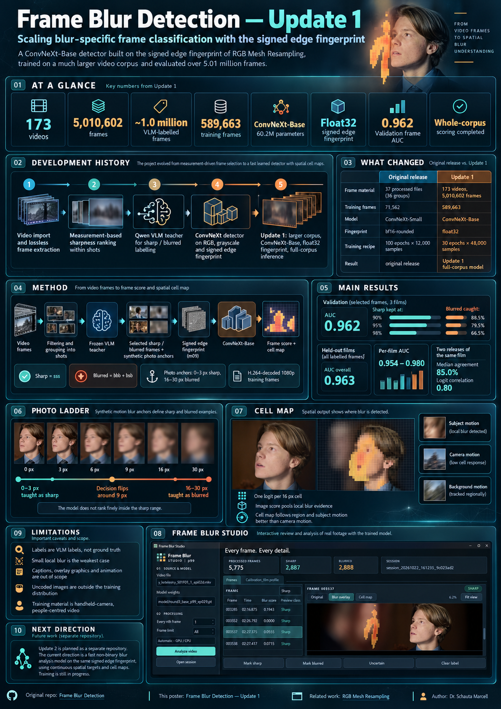
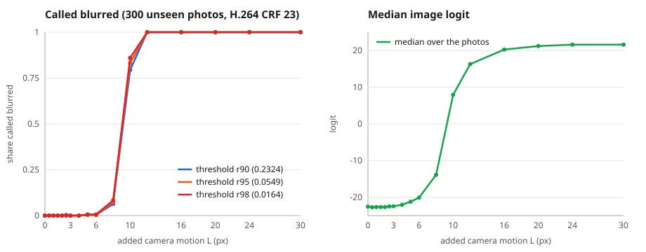

# Frame Blur Detection — Update 1



The second published model of [Frame Blur Detection](https://github.com/mschauta/frame-blur-detection): a blur-specific
sharp / blurred classifier for video frames, on the same input as before — the signed edge fingerprint of the
[RGB Mesh Resampling](https://github.com/mschauta/rgb-mesh-resampling) `m09` reconstruction — and with the same
synthetic photo anchors. What changed is the scale and the model: a **much larger frame set (173 videos instead of 37
files)**, a **ConvNeXt-Base** trunk instead of ConvNeXt-Small, and an **exact float32 fingerprint** instead of the
bf16-rounded one.

The task, the principles, the labelling, the photo construction and the model design are described in the original
repository's [README](https://github.com/mschauta/frame-blur-detection#readme) and
[METHOD.md](https://github.com/mschauta/frame-blur-detection/blob/main/METHOD.md). The development history below explains how the approach evolved. The rest of this repository focuses on
Update 1: [METHOD.md](METHOD.md) lists the changes section by section, and [reproduction/](reproduction/) holds
the aggregate evidence behind the reported results.

## Development history

Frame Blur Detection grew out of an attempt to **measure sharpness in video**, not out of an initial plan to train a
binary image classifier. Each change of method addressed a limitation found in the previous stage. The long-term goal
has remained the same: assess whether a video frame is acceptably sharp without a different manually tuned rule for
each scene, camera view or source.

### 1. Building the video dataset

The first software pipeline imported videos, decoded their frames at the source frame rate and stored the decoded
images losslessly. Frames with burnt-in subtitles or overlaid text were excluded. SAM3-assisted identification of
video watermarks helped construct per-video validity masks; those regions could then be excluded from measurements,
and masked or deliberately left visible during model training.

Frames were grouped by visual similarity into short, relatively stable framing units called *shots*. These were
analysis units, not necessarily editorial cuts: changes in camera position or framing could divide a continuous take.
This grouping made it possible to compare frames under approximately similar visual conditions.

### 2. Why direct measurement was not enough

The original approach combined single-frame sharpness measurements with evidence from **neighbouring frames**.
Comparisons of the preceding, current and following frames estimated camera and regional motion; within-shot sharpness
ranking identified relatively better and worse frames. Temporal evidence was valuable because an isolated image does
not reveal how the subject or camera moved between exposures.

But measured inter-frame motion is **not the same as exposure blur**. Shutter time was generally unknown; fine detail,
smooth surfaces, subject distance, camera movement and composition all affected how much blur was visible. Thresholds
that worked on medium or long shots failed on close-ups and extreme close-ups. Attempts to determine shot size
automatically were also unreliable, preventing robust view-specific thresholds.

The measurements were therefore retained for **ranking and consistency checks within a shot**, not as a universal
absolute label or a model input. A source-independent sharp/blurred boundary still had to be learned.

### 3. The Qwen teacher: a workable visual judgement, with label noise

The breakthrough in dataset labelling came from a frozen **Qwen3.5-4B** vision-language model. In pilot observations
it judged difficult close-ups and low-texture surfaces more usefully than the hand-designed thresholds, without first
requiring a reliable camera-view classification. This was a practical improvement in the evaluated material, not proof
of viewpoint-independent accuracy on arbitrary images.

Although the desired output was initially binary, the final labelling procedure asked **three separate yes/no
questions**: one about visible blur or motion blur, one about whether the *video frame* is sharp, and one about whether
the *image* is sharp. Responses were preserved as codes. In the original selection, `sss` was retained as sharp and
`bbb` / `bsb` as blurred; contradictory and borderline combinations were excluded. Later selection rules also
introduced film-relative handling of some `ssb` frames.

This improved the ability to filter ambiguous cases, but it also exposed sensitivity to wording and image content.
The labels remained **teacher judgements, not independently established ground truth**. In addition, three VLM
queries per frame made large-scale labelling computationally expensive. The next objective was a much faster
dedicated model that could learn from the retained labels without running Qwen on every new frame.

### 4. ConvNeXt and the signed edge fingerprint

The detector experiments used pretrained ConvNeXt backbones. A DINOv3-pretrained ConvNeXt-Small was tested, but
under the tested training recipe the **ImageNet-pretrained ConvNeXt** was preferred.

The original research direction was the **signed edge fingerprint** inherited from
[RGB Mesh Resampling](https://github.com/mschauta/rgb-mesh-resampling). The earlier `m09` mesh reconstruction
defines a signed luminance residual, `d = Y − K * Y`: the part of the image not preserved by the reconstruction.
It emphasises fine structure and can retain signed patterns associated with broadened or repeated contours. The
residual also contains texture, noise and codec artefacts; it is not a pure or physically calibrated blur measurement.

To test whether this representation was actually useful, the first published study trained otherwise comparable
models on **RGB**, **grayscale** and the **signed edge fingerprint**. All three carried substantial information for
the reported discrimination task; the results did not establish that the fingerprint was universally superior.
The fingerprint remained the chosen line of development because it directly extended the author's mesh experiments
and allowed blur-related edge structure to be studied without feeding the model conventional colour imagery.

### 5. Synthetic anchors for a problem without absolute sharpness labels

Real video frames do not provide a clean physical reference for "perfectly sharp". Even a frame selected as sharp
relative to its shot may contain native motion blur, intentional defocus or compression artefacts; blur itself spans
a continuum rather than two natural categories.

The training therefore combined selected real frames with **controlled synthetic photographs**. Original
photographs were accepted as composition-level sharp references, then given known amounts of added camera-motion
blur. The original training construction assigned **0–3 px** of added blur to the sharp class and **16–30 px** to the
blurred class; intermediate synthetic lengths were **not trained**. The model had to encounter the intervening
transition through the training evidence rather than through an arbitrary synthetic cut-off label.

The photographs were passed through **H.264 encoding and decoding** before training. This reduced a potential
shortcut in which the residual model might distinguish uncoded synthetic photos from decoded video frames instead
of learning relevant blur patterns. These are construction labels: zero *added* blur does not guarantee that every
part of the source photograph was physically sharp.

### 6. A binary decision built from a spatial cell map

From the first published models, the ConvNeXt head produced **one local logit per 16-pixel cell**, not just one
whole-frame output. A masked log-sum-exp operation pooled the local outputs into a frame-level score. Synthetic
photos also supplied dense cell-level supervision because the injected camera-motion blur applied globally;
native frames supplied image-level labels only.

This design made **cell maps** available alongside sharp/blurred classification. The maps represent learned local
blur evidence, not independently verified pixel-wise segmentation or physical blur length. Their existence nevertheless
made it possible to examine *where* a model was responding, and later motivated training with richer spatial targets.

### 7. First publication: establishing the approach

The original [Frame Blur Detection](https://github.com/mschauta/frame-blur-detection) publication reported
**ConvNeXt-Small** models trained on RGB, grayscale and the signed fingerprint. Its labelled snapshot covered
**37 processed video files (36 distinct groups)**, with **71,562 selected training frames** plus synthetic photo
anchors. The study compared input representations, checked generalisation on video-group splits and documented
limitations of teacher labels, native blur and the synthetic/video coding path.

The central finding was that a dedicated network could learn a useful blur-specific decision from the fingerprint
alone on the evaluated material. Universality across arbitrary video sources remained an aim, not a demonstrated
property.

### 8. Update 1: scaling the material and improving the fingerprint

**This repository is Update 1.** It expands the corpus to **173 videos and 5,010,602 frames**, with
**589,663 selected training frames** and the same synthetic photo pool. The detector grows from ConvNeXt-Small to
**ConvNeXt-Base**, while the `m09` fingerprint changes from a bfloat16-rounded convolution to an explicitly
**float32** calculation. The revised selection rules treat films, including alternate-bitrate releases, as units;
frame measurements still serve only as within-shot ranking or independent checks.

After the `round3_base_p99_ep029.pt` checkpoint had been fixed, the trained detector was run over the
**entire 5.01-million-frame corpus**, producing frame scores and spatial cell outputs. The results and their
limitations are documented below. In particular, the frame score is still a **thresholded classifier score**,
not a calibrated continuous measurement of physical blur.

This shift also matters operationally. Preliminary pipeline observations suggest that the Qwen teacher labels
about **40,000 frames/day**, whereas Round 3 processed the complete corpus in roughly **one day** for frame scores
and about **26 hours** with cell maps. These are **not controlled benchmarks**: timing boundaries, hardware
utilisation and the earlier measurement/import costs still need separate reproducible profiling. Training time,
inference time and video preparation must not be conflated.

### Next research direction — Update 2 (training in progress)

A **separate future repository** is planned for Update 2; it is **not a completed result of this release**.
The experiment currently being trained, `v9_base_selfmap_v2`, keeps the **signed edge fingerprint** and
ConvNeXt-Base architecture but proposes a different learning target: rather than primarily reproducing binary
sharp/blurred labels, it uses the preceding model's **continuous cell-level predictions as soft targets** across
approximately **4.85 million training frames**, with controlled synthetic photographs retained.

The intended outputs are a **continuous frame-level blur measure** (weighted blur mass, `M`) and a
**spatial cell map**, with fast inference on the fingerprint representation. This is a form of spatial
self-distillation: the earlier model supplies training targets, rather than directly donating its trained
weights. Teacher-generated targets may also propagate errors and are **not independent ground truth**.

**Training is still underway.** No Update 2 accuracy, speedup or final training outcome is claimed here;
its implementation, benchmarks and evaluation will belong to the separate Update 2 publication.

## What changed

| | Frame Blur Detection (100-epoch runs) | Update 1 |
|---|---|---|
| frame material | 37 processed video files (36 groups) | 173 videos, 5,010,602 frames, ~1.0 million labelled by the same frozen VLM teacher |
| frame selection | sharp = `sss`, per shot only the best 20% by measured sharpness (10% if most of the shot is blurred), ≥ 0.2 s apart; blurred = `bbb` + `bsb`, all kept | v8 rules: films as units (both releases of a film twice released at different bitrates), a film-relative sharp class, the measurement only ranks inside a shot, no thinning (METHOD §5) |
| training frames | 71,562 (13,198 sharp, 58,364 blurred), 18 video groups | 589,663 (349,624 sharp, 240,039 blurred) |
| validation / test | 11 / 7 video groups, 3,301 / 3,296 frames per class | 3 / 3 films chosen by hand, 16,190 / 20,732 frames per class; none of their frames trained on |
| photo anchors | 33,484 training photos, 0–3 px sharp / 16–30 px blurred, through H.264 | **unchanged** |
| fingerprint | computed inside bf16 autocast (bf16-rounded) | computed in float32, outside autocast |
| model | ConvNeXt-Small (~34 M parameters) to stride 16 | ConvNeXt-Base (60.2 M parameters) to stride 16; the same head and pooling |
| training | 100 epochs × 12,000 samples (1.2 M) | 30 epochs × 48,000 samples (1.44 M), 90,440 optimizer steps |
| result | the last epoch | the last epoch |

## Weights

The weight file is attached to the [release](../../releases) (230 MB; not stored in the repository):

| file | sha256 | input | epoch | thresholds r90 / r95 / r98 | validation frame AUC |
|---|---|---|---|---|---|
| `round3_base_p99_ep029.pt` | `9840160f0c337fc1312c2566abf4231be0bd7ee709f65f489fd8f81c65b8d0e6` | edge fingerprint | 29 (last of 30) | 0.2324 / 0.0549 / 0.0164 | 0.962 |

A frame is called blurred when its score (the sigmoid output, not a calibrated probability) reaches the threshold; the
three thresholds catch 90 / 95 / 98% of the blurred validation frames. The file holds the state dict and its metadata;
the metadata keys `arch` and `fingerprint` tell the included loader to build ConvNeXt-Base with the float32
fingerprint. The weights of the original repository load unchanged with this code.

```
pip install -r requirements.txt
# put round3_base_p99_ep029.pt into weights/
python classify.py --weights weights/round3_base_p99_ep029.pt --input frames --output sorted --recall 95
```

`classify.py` reports whether the weight file is the published release asset (by its sha256), writes `results.csv` as
it goes, continues an interrupted run with `--resume` (also after `--move`), and with `--dry-run` only scores, into
`results_dry_run.csv`.

Tests (no private data needed; the weight-file test runs when `weights/round3_base_p99_ep029.pt` is present):

```
pip install pytest
python -m pytest
```

They cover the fingerprint in both precisions, the model input and its validity channel, output shapes and cell
validity, loading of old and new weight files, the evidence files (strict JSON, and the numbers quoted here), and
`classify.py`. One test is an expected failure: the validity-mask leak described under Limitations.

The model expects what it was trained on: **video frames decoded from H.264** (1080p in training), stored losslessly.
Uncoded images are outside its training distribution (see the cell map below).

## Results

### Validation (selected frames, 3 films)

16,190 sharp and 16,190 blurred frames selected by the v8 rules, and 4,000 photo variants
([validation_epoch29.json](reproduction/validation_epoch29.json)):

| | AUC | sharp frames kept at 90 / 95 / 98% blurred caught |
|---|---|---|
| frames | 0.962 | 88.5 / 79.5 / 66.5% |
| photos (0–3 px vs 16–30 px) | 1.000 | — |

### Held-out films, every labelled frame

All VLM-labelled frames of the six held-out films, scored once after the checkpoint had been fixed. Sharp = `sss` (plus
`ssb` in films where `ssb` dominates), blurred = `bbb` + `bsb`; the thresholds come from the validation selection, so
the caught share on all labelled frames is close to, but not exactly, 90 / 95 / 98%
([heldout_films.json](reproduction/heldout_films.json)):

| films | sharp | blurred | AUC | kept / caught at r95 | kept / caught at r98 |
|---|---|---|---|---|---|
| validation (3) | 37,133 | 17,886 | 0.958 | 79.9% / 94.4% | 66.1% / 97.7% |
| test (3) | 33,877 | 25,791 | 0.966 | 81.0% / 95.3% | 69.8% / 97.0% |
| all six | 71,010 | 43,677 | 0.963 | 80.4% / 95.0% | 67.9% / 97.3% |

Per film the AUC is 0.954–0.980. The 95% intervals, from a bootstrap over shots (frames of one shot are not
independent), are 0.951–0.965 (validation), 0.955–0.975 (test) and 0.954–0.969 (all six). They hold for these six films;
three films per group cannot measure how much another film would differ. These numbers are **not directly comparable**
with the original 100-epoch runs: the frame material, the selection and the split are different.

### Consistency over the whole corpus

All 5,010,602 frames of the 173 videos were scored ([corpus_checks.json](reproduction/corpus_checks.json)).

- **Scene consistency.** Within shots that hold both decisions (95% point), the measured motion separates the model's
  blurred frames from its sharp ones with a median AUC of 0.854; the VLM labels reach 0.863. The measurement is a
  separate, non-learned motion and sharpness measurement that was never a model input.
- **Two releases of the same film.** For 31 films released twice at different bitrates, frames matched by time agree
  at the 95% point with a median of 85.0% (Cohen's κ 0.68; Pearson correlation of the logits 0.80).
- **By dominant motion** (labelled blurred frames caught at r95): camera / global motion 98.5%, subject / local motion
  93.1%, mixed 99.2%. Small local blur is the weakest case.

### Photo ladder

300 unseen photos with uniform camera motion of known length, one direction per photo, through H.264 CRF 23
([photo_ladder_epoch29.json](reproduction/photo_ladder_epoch29.json)):



The decision flips at about **9 px** at all three thresholds (98%: 8 px 8%, 10 px 86%, 12 px 100%): the logit jumps
from −14 to +8 between 8 and 10 px. From 0 to 6 px the logit stays saturated around −22, so **the score does not rank
inside the sharp range** (pairwise order accuracy 0.62 for 0–3 px, 0.99 for 3–16 px). This follows from the training
construction: 0–3 px are taught as sharp, 16–30 px as blurred, and the 4–15 px gap is never trained. A later model will
use a different photo ladder; this one belongs to Update 1.

### Cell map

The model gives one logit per 16 px cell (`out["local"]`); the image score pools them. On 3,981 unseen photos with no
added blur, passed through H.264 CRF 23, no cell exceeds logit 0.06 (one photo reaches 0). The same photos **without**
coding produce a cell at or above 0 in 18.7% of the cases, and some are called blurred: the model relies on the coding
chain it was trained on. Against the motion measurement, the cell map agrees with where the subject moves (median
within-frame Spearman 0.34 over 160 px cells, 2,000 held-out frames). The image score follows region and subject motion
(Spearman 0.71 / 0.73) much more than camera motion (0.20).

## Limitations

- **Labels are VLM labels.** Agreement with them is not ground truth; the consistency checks above are witnesses, not
  proofs.
- **Small local blur** is caught less often than global blur, and the score does not rank within 0–3 px.
- **Captions, overlaid graphics and animation are out of scope.** The watermark training teaches the model to ignore
  overlaid layers (masked on half of the frames, visible on the other half); on captions it is unreliable.
- **Filmic material.** On a professionally produced drama episode the cell map is mostly placed well, but deliberate
  shallow depth of field (an out-of-focus partner in a dialogue) is often called blurred, and motion seen through a car
  window is real blur that a film may accept. The training material comes from handheld-camera, people-centred videos.
- **Uncoded images** are outside the training distribution.
- **Validity masks leak at their border.** With a mask, the fingerprint of a valid pixel next to the mask is still
  computed from the masked neighbours, and those pixels enter the per-image p99 scale. On a 1080p frame with a 160 px
  masked strip, white content under the mask moves the scale by +14% (black: +8%), i.e. every valid value by about
  −6% (−4%). The published weights were trained with this behaviour (masks on half of the samples), so it is
  documented and tested (`tests/test_model.py`, expected failure) rather than changed; `classify.py` uses no mask.

## Data availability

As in the original repository: the training data is **not published**, it was built from copyrighted videos and
photographs, and no images, frames, crops or derived images from it are published. Published are the method, the
selection rules, the reported aggregate metrics, the inference code and the trained weights.

## Related work by the author

- [Frame Blur Detection](https://github.com/mschauta/frame-blur-detection): the method, the RGB / grayscale / edge
  fingerprint comparison, the first published weights and the evidence package.
- [RGB Mesh Resampling](https://github.com/mschauta/rgb-mesh-resampling): the continuous RGB-mesh reconstruction from
  which the edge fingerprint is derived.

## License

[MIT](LICENSE) © Dr. Schauta Marcell
